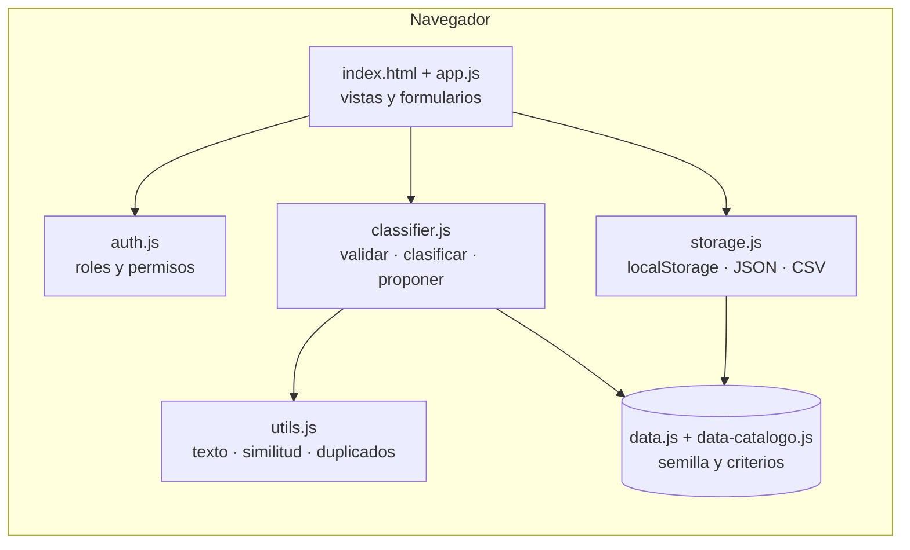
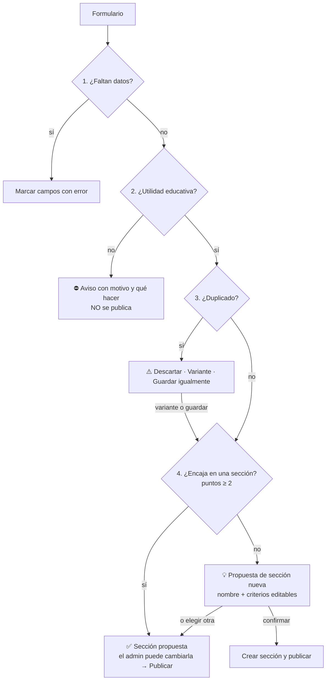

# Arquitectura y modelo de datos

Este documento describe cómo está construida la plataforma **Recursos SAFA** y por qué.
Sigue el documento de especificaciones *«Plataforma de Recursos Educativos DUA»* y añade lo que pide la tarea: inicio de sesión, roles, categorías y subcategorías, clasificación automática, propuesta de categorías nuevas y descarte de recursos sin utilidad educativa.

## 1. Tecnologías

| Decisión | Valor | Origen |
|---|---|---|
| Lenguajes | HTML5 semántico, CSS3, JavaScript ES6+ (Vanilla) | Especificación |
| Dependencias | Ninguna: sin librerías, sin compilación, sin servidor | Especificación |
| Arranque | Abrir `index.html` (también funciona con `file://`) | Especificación |
| Datos | `localStorage` del navegador + semilla en `js/data*.js` | Especificación |
| Importar / exportar | JSON y CSV | Especificación |
| Accesibilidad | WCAG 2.1 AA: teclado, `aria-live`, foco visible, alto contraste | Especificación |
| Duplicados | URL canónica → Levenshtein (≥ 0,85) → Levenshtein (≥ 0,70) + Dice (≥ 0,65) | Especificación |

## 2. Estructura de archivos

```
index.html                 Punto de entrada: inicio de sesión, catálogo, administración y ayuda
css/styles.css             Tokens de color, diseño adaptable, alto contraste y letra grande
js/data-catalogo.js        363 recursos generados desde el Excel (no editar a mano)
js/data.js                 Listas fijas, categorías y criterios, reglas de validación, 12 recursos del documento, cuentas de prueba
js/utils.js                Normalización, Levenshtein, Sørensen-Dice, detección de duplicados, SHA-256, escape de HTML
js/storage.js              Guardado en localStorage, copia de seguridad JSON, lista CSV, importación
js/auth.js                 Inicio de sesión, roles y permisos, gestión de cuentas
js/classifier.js           Validación de utilidad educativa, clasificación automática, propuesta de categoría
js/app.js                  Interfaz: vistas, filtros, fichas, formularios, panel de administración
herramientas/generar_catalogo.py   Convierte el Excel en js/data-catalogo.js
pruebas/clasificador.test.js       Pruebas de la lógica (node --test)
pruebas/e2e.js                     Prueba con navegador real (Playwright)
docs/                      Esta documentación y las guías de uso
```

Los archivos `auth.js`, `classifier.js` y `data-catalogo.js` no aparecen en el documento de especificaciones. Se añaden para cubrir los requisitos nuevos de la tarea sin mezclar responsabilidades en `app.js`.

## 3. Capas y flujo



Orden de carga de los scripts (en `index.html`): datos → utilidades → almacenamiento → permisos → clasificador → interfaz.

## 4. Modelo de datos

### 4.1 Recurso

Se usa el esquema del documento de especificaciones y se le añaden los campos de la tarea (en **negrita**).

| Campo | Tipo | Obligatorio | Descripción |
|---|---|---|---|
| `id` | texto | sí | Identificador único (`rec_…`, `xls_…`, `imp_…`) |
| `name` | texto | sí | Título del recurso |
| `url` | texto | sí, salvo que haya archivo | Enlace http/https |
| **`file`** | objeto | no | Archivo subido: `{ name, type, size, dataUrl }` (máx. 1,5 MB) |
| `description` | texto | sí (≥ 15 caracteres) | Descripción breve en lenguaje sencillo |
| **`category`** | texto | sí (automático) | Nombre de la categoría |
| **`subcategory`** | texto | sí (automático) | Nombre de la subcategoría («sección» en la interfaz) |
| `areas` | lista | no (se propone) | Materias |
| `stages` | lista | calculado | Infantil / Primaria, a partir de `grades` |
| `grades` | lista | no (se propone) | Cursos sugeridos; incluye «Para el docente» |
| `dokLevel` | 1–4 | no (se propone) | Profundidad de conocimiento de Webb |
| `methodology`, `activityType`, `competencies` | texto / lista | no | Datos pedagógicos |
| `sdtElements`, `udlPrinciples` | lista | no | Autodeterminación y principios DUA |
| `accessibilityFeatures`, `supportNeeds` | lista | no | Accesibilidad y atención a la diversidad |
| `language`, `cost`, `license` | texto | no | Idioma, precio y licencia |
| **`interest`** | Alta / Media | calculado | Interés para el proyecto docente (como en el Excel) |
| **`linkType`** | texto | calculado | Página web, Documento PDF, Vídeo, Repositorio, Archivo subido |
| **`createdAt`, `createdBy`, `updatedAt`, `updatedBy`** | texto | automático | Trazabilidad |

### 4.2 Categoría y subcategoría

```json
{
  "id": "cat_edu",
  "name": "Educación y recursos docentes",
  "icon": "🍎",
  "description": "Recursos pensados para el aula y para el trabajo del docente.",
  "subcategories": [
    {
      "id": "sub_mates",
      "name": "Matemáticas",
      "icon": "➗",
      "keywords": ["matematicas", "numeros", "sumas", "fracciones", "geometria"],
      "defaults": { "areas": ["Matemáticas"], "grades": ["1º Primaria", "…"], "dokLevel": 2 }
    }
  ]
}
```

- `keywords` son los **criterios de categorización** de la sección. El administrador puede verlos y editarlos.
- `defaults` son la materia, el curso y el DOK que se proponen cuando el formulario los deja vacíos.
- Los recursos guardan el **nombre** de su categoría y subcategoría (como en el Excel). Al renombrar una sección, se actualizan sus recursos.

Las categorías iniciales son las del Excel con interés alto o medio para el proyecto docente: *Educación y recursos docentes* (11 secciones), *Inteligencia artificial – Herramientas* (6) y *Formación y cursos* (2).

### 4.3 Usuario

| Campo | Descripción |
|---|---|
| `id`, `username`, `displayName` | Identificación |
| `role` | `admin` o `docente` |
| `salt`, `passwordHash` | Contraseña cifrada con SHA-256 y sal (nunca en texto plano) |
| `active`, `createdAt` | Estado y fecha de alta |

### 4.4 Almacenamiento

| Clave | Contenido |
|---|---|
| `localStorage.eduinclusiva_catalog_store_v1` | Recursos (nombre de clave del documento) |
| `localStorage.eduinclusiva_categories_v1` | Categorías y criterios |
| `localStorage.eduinclusiva_users_v1` | Cuentas |
| `localStorage.eduinclusiva_prefs_v1` | Alto contraste y letra grande |
| `sessionStorage.eduinclusiva_session` | Sesión abierta (se cierra al cerrar la pestaña) |

## 5. Permisos

| Acción | Docente | Administración |
|---|:-:|:-:|
| Ver, buscar y filtrar el catálogo | ✅ | ✅ |
| Abrir enlaces y descargar archivos / lista CSV | ✅ | ✅ |
| Cambiar su propia contraseña | ✅ | ✅ |
| Añadir, modificar y borrar recursos | ❌ | ✅ |
| Crear, renombrar y borrar categorías y secciones | ❌ | ✅ |
| Crear y borrar cuentas, cambiar contraseñas | ❌ | ✅ |
| Importar, exportar y restaurar | ❌ | ✅ |

Los permisos se comprueban en dos sitios: la interfaz oculta los botones y **cada función que cambia datos llama a `EduAuth.require()`** antes de actuar.

## 6. Proceso al insertar un recurso



### 6.1 Criterios de validación de utilidad educativa (`EDU_RULES` en `data.js`)

Basados en la hoja «Resumen» del Excel, que eliminó los enlaces de riesgo, los que tenían datos personales y los temporales, y en las categorías del Excel sin interés para el proyecto docente.

| Regla | Se rechaza si… | Mensaje (resumen) |
|---|---|---|
| Riesgo | Aparecen palabras de piratería, apuestas, contenido adulto, activadores… | «Este recurso no se puede publicar» |
| Enlace temporal | La URL es de inicio de sesión, pago, carrito, confirmación o búsqueda | «Este enlace es temporal» |
| Datos personales | La URL es de correo, sesión, token, documento en edición, red local… | «Este enlace tiene datos personales» |
| Sin señal educativa | La puntuación educativa es < 1 | «No tiene utilidad educativa» |
| Domina lo no educativo | Hay ≥ 2 palabras de compras, viajes, banca, negocio, ocio, trámites o programación profesional y superan a las educativas | «Parece una página de compras y ofertas…» |

Puntuación educativa: palabra educativa = 1 punto (aula, alumnado, primaria, aprender…); palabra de herramienta de creación = 0,5 (vídeo, imagen, IA…, como el interés «Medio» del Excel); palabra de una sección educativa = 0,5. Se aceptan los plurales sencillos.

### 6.2 Criterios de clasificación

Para cada subcategoría se suman puntos:

| Señal | Puntos |
|---|---|
| Palabra clave de la sección en el **nombre** | 2 |
| Palabra clave en la descripción, la URL, la metodología o el tipo de actividad | 1 |
| El mismo sitio web ya tiene recursos en esa sección | 3 |
| La materia elegida es la propia de la sección | 1 |

Gana la sección con más puntos si llega a **2** (`MIN_CATEGORY_SCORE`). La «seguridad» que se muestra es `puntos de la ganadora / (ganadora + segunda)`.
Con el catálogo inicial, el clasificador coincide con la clasificación manual del Excel en el 87 % de los recursos.

### 6.3 Propuesta de categoría nueva

1. Si el texto coincide con un tema educativo que aún no tiene sección (`PROPOSAL_TOPICS`: música, plástica, educación física, emociones, lengua, inclusión, religión, familias, evaluación, organización del aula, medio ambiente), se propone ese nombre y sus palabras clave.
2. Si no, se toman las palabras más repetidas del nombre (que vale doble) y de la descripción, sin palabras vacías, y se forma un nombre («Ajedrez y estrategia») con esas palabras como criterios.
3. El administrador revisa nombre, categoría madre y criterios, y confirma. Hasta que no confirma, no se crea nada.

## 7. Seguridad

- **Inyección de código:** todo texto de usuarios o archivos se escapa con `escapeHtml()`; todos los enlaces pasan por `safeHref()` (solo `http`, `https` o archivos `data:` subidos).
- **Contraseñas:** SHA-256 con sal aleatoria; bloqueo de 1 minuto tras 5 intentos fallidos; mismo mensaje para usuario o contraseña incorrectos.
- **Cuentas de prueba:** se muestran en la pantalla de inicio solo mientras conserven su contraseña original.
- **Enlaces externos:** `target="_blank"` con `rel="noopener noreferrer"` y aviso para lectores de pantalla.
- **Límite importante:** al no haber servidor (lo exige la especificación), el inicio de sesión y los permisos se comprueban en el navegador. Sirven para organizar el uso en el centro, pero no protegen frente a alguien que manipule el navegador. Para publicar en Internet con garantías, hay que llevar `auth.js` y el guardado a un servidor (por ejemplo, una API pequeña con base de datos). La separación en módulos lo facilita: `EduStorage` y `EduAuth` son los únicos puntos que habría que cambiar.

## 8. Decisiones tomadas donde la especificación no era clara

| Tema | Decisión (la opción más sencilla) |
|---|---|
| Algoritmo de categorización | Puntuación por palabras clave, explicable y editable |
| Inicio de sesión sin servidor | Cuentas en `localStorage`, contraseñas con SHA-256 |
| Registro de docentes | Lo hace la administración desde «Cuentas» (no hay autorregistro) |
| Descripción, materia y nivel de los recursos del Excel | El Excel no los trae: descripción escrita a mano para los de interés alto, descripción tipo por sección para el resto, materia y nivel por sección y por pistas del nombre |
| Enlaces personales del Excel | Se sustituyen por la portada del sitio y se quitan parámetros de seguimiento |
| «Subcategoría» | En la interfaz se llama «sección», palabra más sencilla |
| Archivos | Se guardan dentro del navegador (máx. 1,5 MB); para archivos grandes, enlace a Drive |
| Importación con recursos que necesitan sección nueva | No se publican; el informe pide añadirlos uno a uno para que la administración confirme la sección |
| Borrar una sección con recursos | No se permite: primero hay que moverlos o borrarlos |
