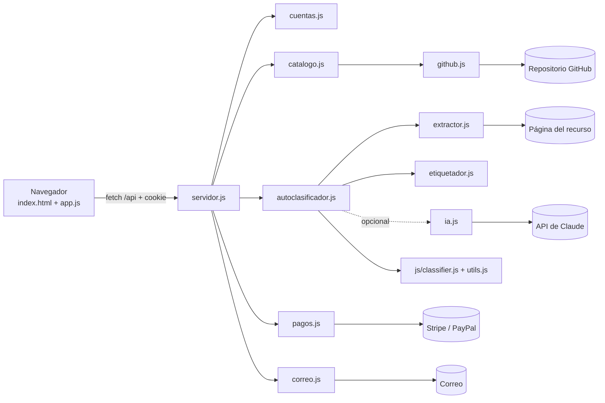
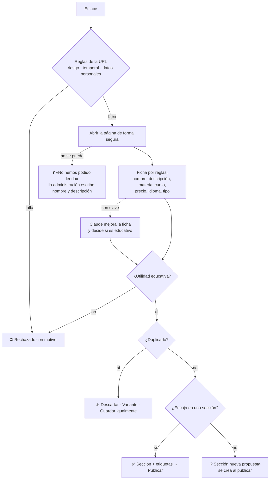

# Arquitectura y modelo de datos (versión 2)

La versión 1 seguía la especificación al pie de la letra: una web estática, sin servidor, con los datos en el navegador. La versión 2 añade lo que pidió la Fundación:
- el repositorio se actualiza con los recursos nuevos;
- los recursos se clasifican y etiquetan con solo su enlace;
- hay perfiles de invitado, VIP y de pago;
- los cursos se desbloquean pagando con Stripe o PayPal.

Todo eso exige un **servidor**, porque en el navegador no se pueden guardar claves secretas, verificar pagos, enviar correos, imponer permisos de verdad ni leer páginas de otras webs.

Lo demás se mantiene: HTML, CSS y JavaScript sin librerías ni compilación en el navegador, la accesibilidad WCAG 2.1 AA y el modelo de datos de la especificación, más sus criterios de clasificación y de validación.

## 1. Tecnologías

| Parte | Tecnología | Por qué |
|---|---|---|
| Interfaz | HTML5, CSS3 y JavaScript sin librerías | Como en la especificación |
| Servidor | Node.js 20+ (`node:http`, sin framework) | Es el mismo lenguaje que la interfaz, así que la lógica de clasificación se reutiliza tal cual |
| Datos | Archivos JSON con escritura atómica | Lo más sencillo para un centro; el catálogo cabe en un archivo que se guarda en GitHub |
| Dependencias | `nodemailer` (correo), `@anthropic-ai/sdk` y `zod` (ficha con IA, opcional) | Las mínimas imprescindibles |
| Pagos | API REST de Stripe Checkout y de PayPal Orders v2 | Pago en páginas alojadas por ellos: la plataforma nunca ve tarjetas |

## 2. Estructura

```
index.html, css/, js/          Interfaz (la sirve el servidor)
  js/api.js                    Peticiones al servidor
  js/app.js                    Vistas: entrar, catálogo, cursos, administrar, ayuda
  js/utils.js                  Texto, similitud, duplicados (compartido con el servidor)
  js/data.js                   Categorías, criterios y reglas de validación (compartido)
  js/classifier.js             Validación educativa y clasificación (compartido)
servidor/
  servidor.js                  Rutas, cookies, CSRF, cabeceras de seguridad
  config.js                    Variables de entorno
  almacen.js                   Archivos JSON con escritura atómica
  compartido.js                Carga js/data.js, utils.js y classifier.js en el servidor
  cuentas.js                   Perfiles, contraseñas (scrypt), sesiones, invitados, permisos
  catalogo.js                  Recursos, categorías, secciones, archivos, cursos
  extractor.js                 Descarga segura de una página y lectura de su HTML
  etiquetador.js               Nombre, descripción, materia, curso, precio, idioma y etiquetas por reglas
  ia.js                        Ficha redactada por Claude (opcional)
  autoclasificador.js          Del enlace a la ficha: reglas → página → IA → validar → duplicados → sección
  pagos.js                     Stripe y PayPal
  correo.js                    Envío del enlace de invitado
  github.js                    Subida periódica del catálogo al repositorio
  scripts/construir-catalogo.js  Crea data/catalogo.json a partir de las semillas
data/
  catalogo.json                Catálogo vivo (se guarda en GitHub)
  semilla/                     12 recursos del documento + 363 del Excel
  archivos/                    Archivos subidos (se guardan en GitHub)
  privado/                     Cuentas, sesiones, pagos, cursos (NO se suben; .gitignore)
pruebas/                       Pruebas de lógica, de servidor y con navegador
```

El servidor solo entrega los archivos de la interfaz que están en una lista cerrada. Nunca entrega `data/` ni `servidor/`, así que el catálogo completo no se puede descargar sin permiso.

## 3. Flujo



## 4. Perfiles y permisos

| Acción | Invitado | Docente | VIP | De pago | Administración |
|---|:-:|:-:|:-:|:-:|:-:|
| Ver la selección de prueba | ✅ | ✅ | ✅ | ✅ | ✅ |
| Ver **todos** los recursos | ❌ | ✅ | ✅ | ✅ | ✅ |
| Descargar archivos y la lista CSV | ✅ (de la selección) | ✅ | ✅ | ✅ | ✅ |
| Ver los cursos (títulos) | ✅ | ✅ | ✅ | ✅ | ✅ |
| Ver el **contenido** de los cursos | ❌ | ❌ | ❌ | ✅ si ha pagado | ✅ |
| Pagar los cursos | ❌ | ❌ | ❌ | ✅ | — |
| Cambiar su contraseña | ❌ | ✅ | ✅ | ✅ | ✅ |
| Añadir, modificar o borrar recursos, secciones, cuentas y cursos | ❌ | ❌ | ❌ | ❌ | ✅ |

Las comprobaciones de permiso se hacen en el servidor (`Cuentas.can()` en cada ruta). El navegador solo oculta botones para no confundir.

- **Invitado:** la administración pone su correo (o la propia persona lo pide en la pantalla de inicio). La plataforma genera un usuario (`invitado-xxxxxx`), una contraseña y un enlace secreto (`/acceso/<código>`) que entra directamente. Caduca a los `GUEST_DAYS` días (14 por defecto). Solo ve los recursos marcados como «Visibles para invitados»: al empezar, los 2 más recomendados de cada sección educativa (19 recursos).
- **VIP** y **de pago:** las cuentas las crea la administración. La de pago tiene un campo `paidUntil`, que el servidor rellena cuando **confirma** el pago con Stripe o PayPal.

## 5. Modelo de datos

### Recurso (`data/catalogo.json` → `resources[]`)

Mantiene los campos de la especificación y de la versión 1, y añade:

| Campo | Descripción |
|---|---|
| `tags` | Etiquetas automáticas (hasta 8): materias, palabras de la sección, «Gratuito», «Documento PDF», «Para el docente»… |
| `guestSample` | `true` si lo ven los invitados |
| `file` | `{ name, type, size, path }`. El archivo está en `data/archivos/<id>/` y solo se descarga con permiso (`/api/archivos/<id>`) |

### Usuario (`data/privado/usuarios.json`)

```json
{ "id": "usr_…", "username": "invitado-3fa2c1", "displayName": "Lucía", "email": "lucia@…",
  "role": "invitado", "active": true, "expiresAt": "2026-11-24T…", "paidUntil": null,
  "salt": "…", "hash": "…(scrypt)", "guestTokenHash": "…(sha256)" }
```

### Otros archivos privados

| Archivo | Contenido |
|---|---|
| `sesiones.json` | `{ tokenHash, userId, expiresAt }`. Solo se guarda el resumen del código de la cookie |
| `pagos.json` | `{ provider, ref, userId, amount, currency, status, paidUntil, createdAt }`. Un pago no se cuenta dos veces |
| `cursos.json` | `{ id, title, description, level, hours, published, lessons:[{title, url, description}] }` |
| `github-pendiente.json` | Archivos pendientes de subir a GitHub |

## 6. Clasificación automática con solo el enlace



- **Lectura segura de la página** (`extractor.js`): solo `http` y `https`, puertos 80 y 443, sin direcciones de la red interna. El servidor comprueba la IP real y se conecta a esa IP, para evitar trucos de DNS. Como máximo 4 redirecciones, 10 segundos y 2 MB.
- **Reglas** (sin IA): las de la versión 1 (`EDU_RULES` y palabras clave de cada sección), ahora aplicadas sobre el título, la descripción, las palabras clave y el texto de la página. `etiquetador.js` añade la detección de materia, curso («2º de primaria», «infantil»…), precio («gratis», «premium»), idioma (`<html lang>`) y tipo de enlace.
- **Con IA** (`ia.js`): una llamada a Claude con salida estructurada validada con `zod`.
  - El modelo es `claude-opus-5-5`, con esfuerzo bajo.
  - Tiene activado el reintento en otro modelo si la petición se rechaza por seguridad (`fallbacks: "default"`).
  - El texto de la página va entre `<pagina>…</pagina>` y se trata solo como datos.
  - Si la IA falla o no está configurada, se usan las reglas.
  - Si la IA dice que **no** es educativo, se rechaza. Si dice que **sí**, su criterio prevalece sobre el recuento de palabras, porque ha leído la página entera. Las reglas de URL (riesgo, temporal, personal) se aplican siempre antes.
- **Al publicar**, el servidor vuelve a validar:
  - limpia los campos con una lista cerrada;
  - comprueba los campos obligatorios, las reglas de URL, la utilidad educativa (o el análisis de la última hora) y los duplicados;
  - comprueba que la sección exista.

  Nada que no tenga utilidad educativa se puede publicar, aunque se manipule el navegador.

## 7. Pagos

1. La persona de pago pulsa «Pagar con tarjeta» o «Pagar con PayPal».
2. El servidor crea una sesión de Stripe Checkout o un pedido de PayPal **con el importe fijado en el servidor**.
3. La persona paga en la página de Stripe o PayPal.
4. Al volver, el servidor **consulta** (Stripe) o **cobra** (PayPal) la operación y comprueba tres cosas: que está pagada, que es de esa cuenta y que el importe coincide.
5. Además, Stripe avisa por webhook firmado; la firma HMAC-SHA256 se comprueba con 5 minutos de margen.
6. Cada pago se apunta una sola vez y suma `PAID_ACCESS_MONTHS` meses de acceso a los cursos.

## 8. Actualización del repositorio

`github.js` sube `data/catalogo.json` y los archivos nuevos o borrados de `data/archivos/` mediante la API «Contents» de GitHub:
- cada `SYNC_INTERVAL_HOURS` horas;
- o al pulsar «Guardar ahora en GitHub»;
- y al arrancar el servidor se revisa por si quedó algo sin subir.

Cada subida es un cambio en el historial con un mensaje del tipo «Actualización automática del catálogo (fecha): N recursos en M secciones».

## 9. Seguridad

- **Contraseñas:** scrypt con sal. Mínimo 8 caracteres con algún número. El mensaje de error es el mismo para usuario o contraseña incorrectos. Como máximo 10 intentos cada 15 minutos por IP.
- **Sesión:** cookie `HttpOnly`, `SameSite=Lax` (y `Secure` con https), de 12 horas, o hasta que caduque la prueba si es invitado. En disco solo se guarda el resumen del código.
- **CSRF:** las peticiones que cambian datos deben llevar la cabecera `X-Requested-With: SAFA`. Otra web no puede añadirla sin permiso CORS, y el servidor no lo da.
- **XSS:** todo texto se escapa con `escapeHtml()` y los enlaces pasan por `safeHref()`. La cabecera CSP prohíbe scripts y estilos en línea y de otros sitios.
- **SSRF:** ver la «Lectura segura de la página» en la sección 6.
- **Archivos:** extensiones permitidas, máximo 1,5 MB y nombre saneado. Se descargan como `attachment` y con permiso.
- **Secretos:** solo en variables de entorno, nunca en el repositorio (`.env` está en `.gitignore`).
- **Datos personales:** nunca se suben a GitHub.

## 10. Decisiones donde la petición no era concreta

| Tema | Decisión (la opción más sencilla) |
|---|---|
| Servidor | Node.js sin framework, porque reutiliza la lógica de la versión 1 |
| Base de datos | Archivos JSON (suficiente para un centro) |
| Stripe o PayPal | Los dos; se activa el que tenga claves |
| Tipo de pago | Pago único que da `PAID_ACCESS_MONTHS` meses (12) de acceso a los cursos, no suscripción |
| Precio | Variable `PRICE_EUR` (49 € por defecto) |
| Qué ven los invitados | Recursos marcados «Visibles para invitados» (19 al empezar); la administración lo cambia por recurso |
| Duración de la prueba | `GUEST_DAYS` (14 días), editable por invitado |
| «Docente» de la versión 1 | Se mantiene como «Docente del centro», con el mismo acceso que VIP |
| Cursos | Contenido privado (no va a GitHub). Dos cursos de ejemplo hechos con recursos del catálogo |
| Repositorio | Se sube el catálogo directamente a la rama configurada (`main` por defecto) |
| IA | Opcional. Sin clave, todo funciona con reglas |
