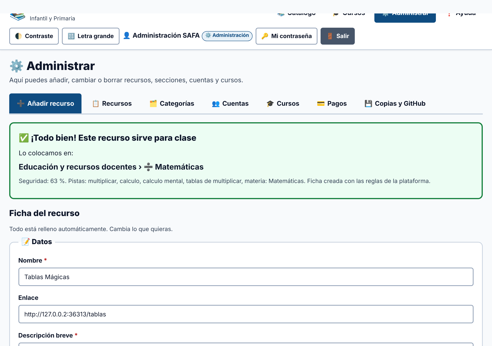
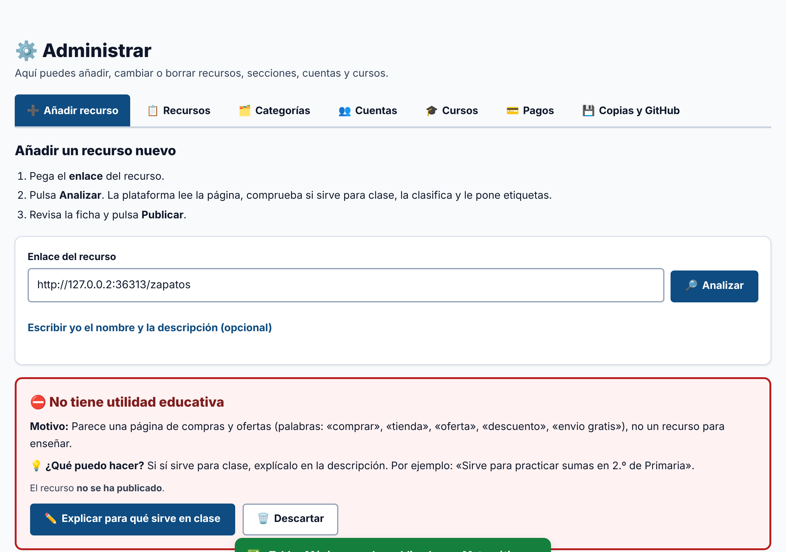
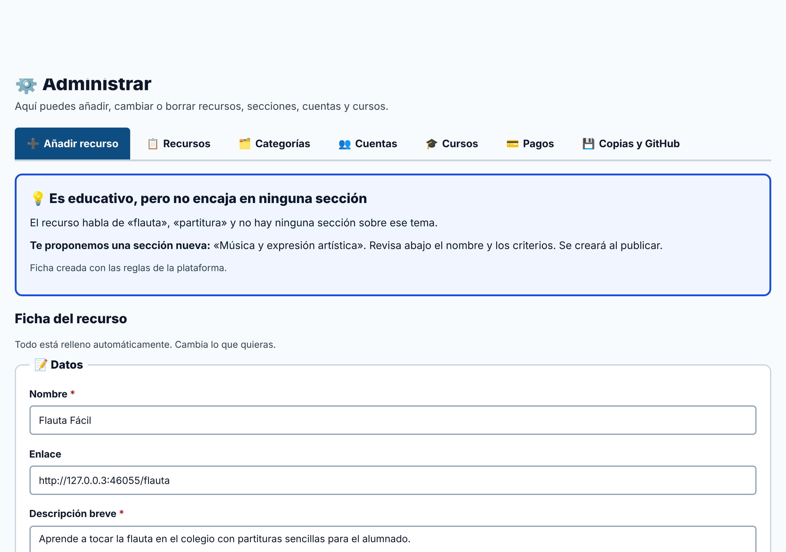
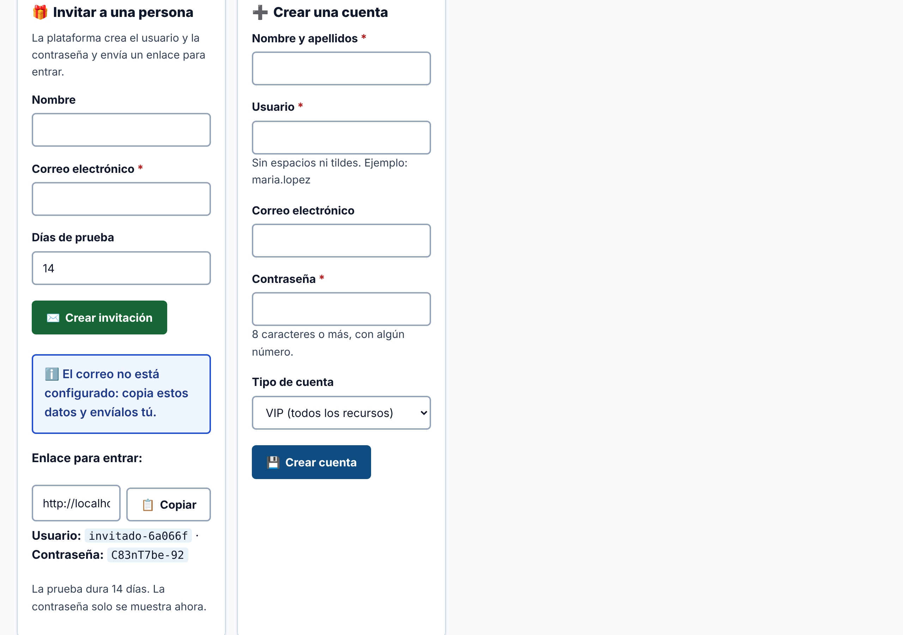

# Guía para administración

La cuenta de administración puede hacerlo todo. Está todo en ⚙️ **Administrar**.

> **Primera vez:** entra con `admin` y la contraseña que te dio quien instaló la plataforma. Cámbiala en 🔑 **Mi contraseña**.

## 1. Añadir un recurso: solo el enlace

1. Ve a ⚙️ **Administrar › ➕ Añadir recurso**.
2. Pega el **enlace** del recurso.
3. Pulsa 🔎 **Analizar** y espera unos segundos.

La plataforma lee la página y hace todo esto sola:
- comprueba si sirve para clase;
- mira si ya existe;
- elige la sección;
- rellena la ficha: nombre, descripción, materia, curso, precio, idioma y **etiquetas**.

4. Revisa la ficha. Cambia lo que quieras.
5. Pulsa 📤 **Publicar recurso**.

Si el recurso no tiene enlace (por ejemplo, una ficha en PDF), abre **«Escribir yo el nombre y la descripción»**, escríbelos y pulsa **Analizar**. Después sube el archivo en **Más datos**.

## 2. Qué puede pasar al analizar

| Aviso | Qué significa | Qué hacer |
|---|---|---|
| ✅ **¡Todo bien!** | Sirve para clase y tiene sección | Revisa y pulsa **Publicar** |
| 💡 **No encaja en ninguna sección** | Es educativo, pero no hay sección para él | Revisa el nombre y los criterios de la **sección nueva** que se propone. Se crea al publicar. También puedes elegir una que ya exista |
| ⚠️ **Puede que ya exista** | Hay otro recurso con la misma dirección o muy parecido | Elige **Descartar**, **Guardar como variante** o **Guardar igualmente** |
| ⛔ **No se puede publicar** | No sirve para clase, o el enlace es peligroso, temporal o personal | Lee el motivo. Si sí sirve para clase, pulsa **Explicar para qué sirve en clase** y escríbelo |
| ❓ **No hemos podido leer la página** | La web no deja entrar a programas | Escribe tú el nombre y una descripción corta |

## 3. Cambiar, borrar y elegir qué ven los invitados

- En el **Catálogo** o en **📋 Recursos**: ✏️ **Editar** o 🗑️ **Borrar**.
- Al editar, 🔄 **Volver a clasificar** te dice qué sección recomienda ahora.
- En **📋 Recursos**, la columna **Invitados** marca qué recursos ven los invitados. También está en la ficha, en **Más datos › Visible para invitados**.

## 4. Perfiles y cuentas

En **👥 Cuentas**:

| Perfil | Ve | Cómo se crea |
|---|---|---|
| 🎁 **Invitado** | Una selección de recursos, unos días | **Invitar a una persona**: escribe su correo. La plataforma crea el usuario, la contraseña y un **enlace para entrar** |
| ⭐ **VIP** | Todos los recursos | **Crear una cuenta** → tipo VIP |
| 💳 **De pago** | Todos los recursos y, **después de pagar**, los cursos | **Crear una cuenta** → tipo De pago. La persona paga desde **🎓 Cursos** |
| 👩‍🏫 **Docente del centro** | Todos los recursos | **Crear una cuenta** → tipo Docente |
| ⚙️ **Administración** | Todo | **Crear una cuenta** → tipo Administración |

- Si el correo está configurado, la invitación **llega sola**. Si no, copia el enlace con 📋 **Copiar** y envíalo tú. La contraseña solo se muestra en ese momento.
- ✏️ **Editar** cambia el nombre, el correo, el tipo, la fecha de fin de la prueba o la fecha hasta la que tiene pagado. También activa o desactiva la cuenta.
- 🔗 **Nuevo enlace** (invitados) crea otro enlace; el anterior deja de funcionar.
- 🔑 **Contraseña** cambia la contraseña de cualquier cuenta.
- 🗑️ **Borrar** elimina la cuenta. No puedes borrar la tuya ni la última de administración.

## 5. Cursos y pagos

- **🎓 Cursos:** crea, cambia o borra cursos. Las lecciones se escriben una por línea: `Título | enlace | descripción`.
- **💳 Pagos:** lista de pagos recibidos y hasta cuándo tiene acceso cada persona.
- El pago se hace en la **página segura** de Stripe o PayPal. La plataforma nunca ve las tarjetas. El acceso se da solo cuando el servidor confirma el pago.

## 6. Categorías y secciones

En **🗂️ Categorías** puedes crear, renombrar y borrar categorías y secciones, y cambiar sus **criterios** (las palabras clave que usa la clasificación). Una sección con recursos no se puede borrar: primero mueve o borra sus recursos.

## 7. GitHub y copias

En **💾 Copias y GitHub**:

- **Guardado en GitHub:** los cambios del catálogo se suben solos al repositorio (cada día por defecto). Pulsa **Guardar ahora en GitHub** si no quieres esperar.
- **Descargar copia (JSON):** todo el catálogo en un archivo.
- **Cargar recursos:**
  - Una copia completa (JSON con categorías) **restaura** todo el catálogo.
  - Una lista (JSON o CSV) revisa y clasifica cada recurso, y al final muestra un informe.

Las cuentas, los pagos y los cursos **no** se suben a GitHub. Quien mantenga el servidor debe hacer copia de la carpeta `data/privado`.

Para instalar y configurar el servidor (correo, Stripe, PayPal, GitHub e IA), consulta [DESPLIEGUE.md](DESPLIEGUE.md).
