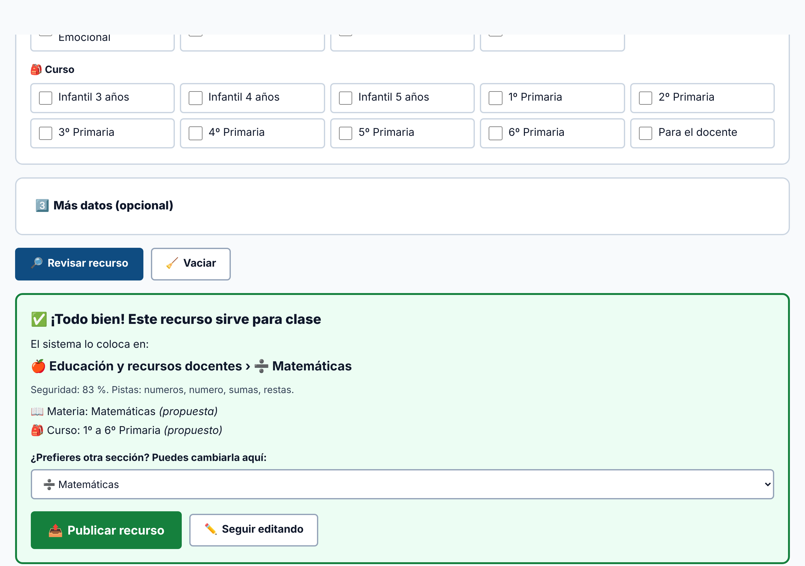
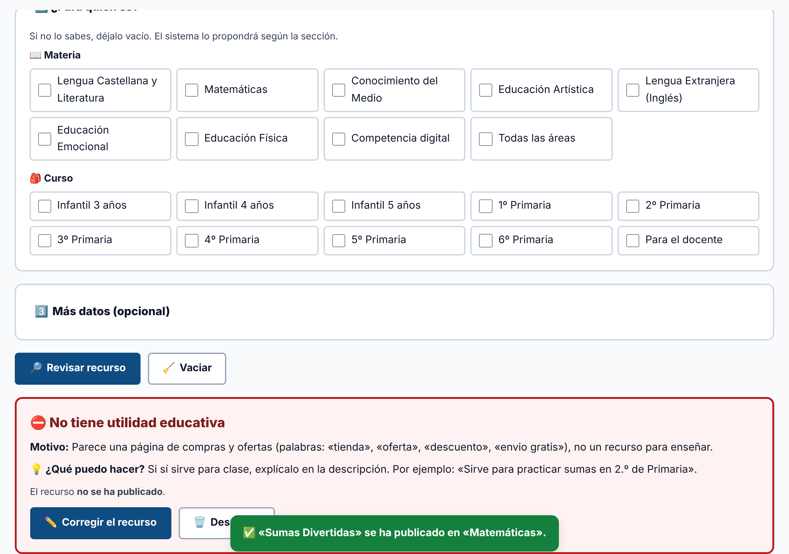
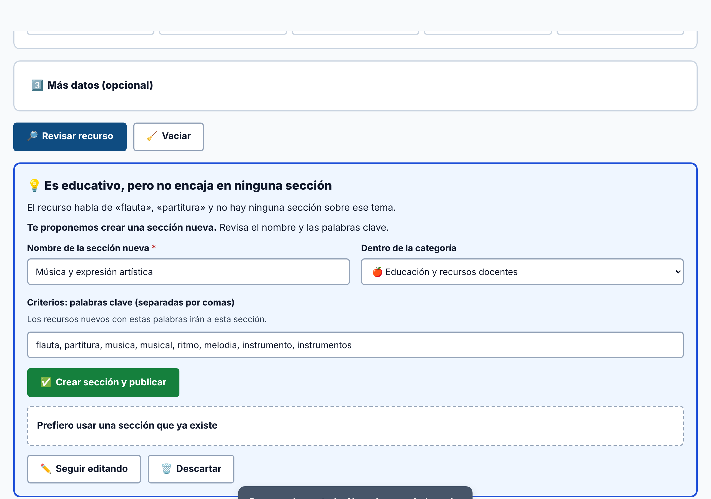

# Guía para administración

La cuenta de administración puede hacer todo lo de un docente y, además, **añadir, cambiar y borrar** recursos, secciones y cuentas. Todo está en ⚙️ **Administrar**.

> **Primera vez:** entra con `admin` / `Admin2026!` y cambia la contraseña en 🔑 **Mi contraseña**. Cambia también la de `docente` (o bórrala) en 👥 **Cuentas**. Mientras no se cambien, la pantalla de inicio las muestra.

## 1. Añadir un recurso

1. Ve a ⚙️ **Administrar › ➕ Añadir recurso**.
2. Rellena los **datos básicos** (con * son obligatorios):
   - **Nombre**.
   - **Enlace**: la página principal del recurso, que pueda abrir cualquiera. O sube un **archivo** (máximo 1,5 MB).
   - **Descripción breve**: para qué sirve en clase, con frases cortas.
3. **¿Para quién es?** Marca materia y curso. Si no lo sabes, déjalo vacío: el sistema lo propondrá.
4. **Más datos** (opcional): DOK, precio, metodología, idioma, accesibilidad, licencia y principios DUA.
5. Pulsa 🔎 **Revisar recurso**.

## 2. Qué puede pasar al revisar

### ✅ Todo bien



El sistema dice **en qué sección va** y por qué (las «pistas»). Puedes cambiar la sección en la lista. Pulsa 📤 **Publicar recurso**.

### ⛔ No se puede publicar



El recurso **no se guarda**. El aviso explica el **motivo** y **qué puedes hacer**:

| Motivo | Qué hacer |
|---|---|
| No tiene utilidad educativa (compras, viajes, banca, negocio, ocio…) | Si sí sirve para clase, explícalo en la descripción |
| Contenido de riesgo (piratería, apuestas, adultos…) | No uses ese enlace; busca la página oficial |
| Enlace temporal (entrar, pagar, buscar…) | Copia la dirección de la página principal |
| Datos personales (tu correo, una sesión, un documento en edición…) | Usa el enlace público |

### ⚠️ Puede que ya exista

El sistema encontró un recurso con la misma dirección o con nombre y descripción muy parecidos. Elige:

- 🗑️ **Descartar**: no se guarda.
- 🔀 **Guardar como variante**: se guarda con «(Variante de uso)» en el nombre.
- 💾 **Guardar igualmente**: se guarda tal cual.

### 💡 Es educativo, pero no encaja en ninguna sección



El sistema propone una **sección nueva** con:

- un **nombre**,
- la **categoría** donde irá,
- unos **criterios** (palabras clave) para colocar ahí los recursos futuros.

Revísalos y pulsa ✅ **Crear sección y publicar**. Si prefieres, abre **«Prefiero usar una sección que ya existe»** y elige otra.

## 3. Cambiar o borrar un recurso

- En el **Catálogo** o en ⚙️ **Administrar › 📋 Recursos**, pulsa ✏️ **Editar** o 🗑️ **Borrar**.
- Al editar, se vuelve a revisar el recurso. La sección actual se mantiene salvo que elijas otra.
- Para **mover** un recurso de sección: edítalo y elige la sección nueva antes de guardar.

## 4. Categorías y secciones

En ⚙️ **Administrar › 🗂️ Categorías**:

- ➕ **Nueva categoría**: nombre, icono y descripción.
- ➕ **Nueva sección**: nombre, icono y **criterios** (palabras clave separadas por comas).
- ✏️ **Editar / Renombrar**: los recursos se actualizan solos.
- 🗑️ **Borrar**: solo si está vacía. Si tiene recursos, primero muévelos o bórralos.

**Consejo para los criterios:** escribe palabras que aparezcan en los nombres y descripciones de esos recursos, sin tildes ni mayúsculas (el sistema las quita igualmente). Una palabra en el nombre de un recurso vale el doble que en la descripción.

## 5. Cuentas

En ⚙️ **Administrar › 👥 Cuentas**:

- Crea cuentas de **Docente** (solo ver y descargar) o de **Administración** (puede cambiar todo).
- Usuario sin espacios ni tildes (por ejemplo, `maria.lopez`). Contraseña de 8 caracteres o más, con algún número.
- 🔑 **Cambiar contraseña** de cualquier cuenta. Comunícala a la persona en privado.
- 🗑️ **Borrar**: no puedes borrar tu propia cuenta ni la última de administración.

## 6. Copias de seguridad

Los datos se guardan **en este navegador**. Si se borran los datos del navegador, se pierden los cambios.

En ⚙️ **Administrar › 💾 Copias**:

- ⬇️ **Descargar copia (JSON)**: hazlo cada semana.
- ⬆️ **Cargar recursos**:
  - Una **copia de esta plataforma** (JSON con categorías) restaura todo.
  - Un **JSON o CSV con recursos** los revisa y clasifica uno a uno. Al terminar verás un informe: publicados, rechazados (con motivo), repetidos y los que necesitan sección nueva (añádelos a mano).
  - Columnas del CSV: `nombre, url, descripción, etapas, áreas, DOK, metodología, accesibilidad, coste`.
- ♻️ **Restaurar catálogo original**: vuelve al catálogo inicial. Las cuentas no se borran.

## 7. Actualizar el catálogo desde el Excel

Si cambia el Excel de clasificación, una persona con conocimientos técnicos puede regenerar el catálogo inicial:

```bash
python3 herramientas/generar_catalogo.py RUTA/Clasificacion_paginas_web.xlsx
```

Después, en 💾 **Copias**, pulsa ♻️ **Restaurar catálogo original** para cargarlo.
