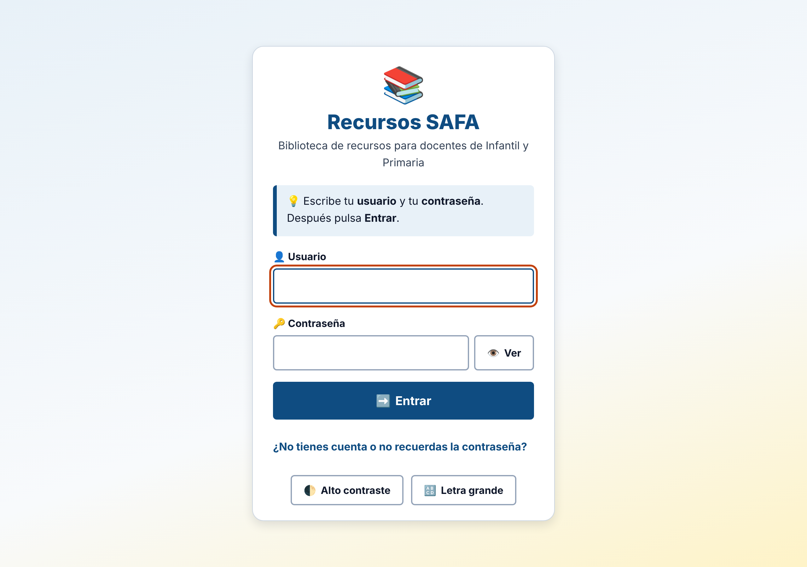
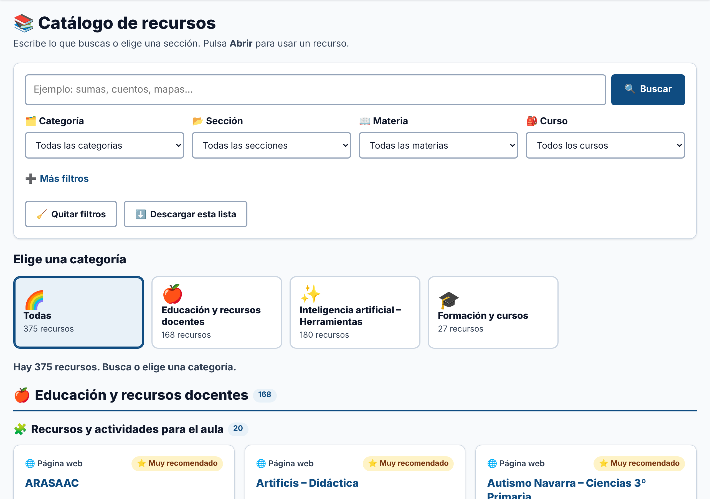

# Guía para docentes

Esta web es una **biblioteca de recursos** para tus clases. Aquí tienes los pasos.

## 1. Entrar

1. Escribe tu **usuario**.
2. Escribe tu **contraseña**. Pulsa 👁️ **Ver** si quieres comprobarla.
3. Pulsa ➡️ **Entrar**.

¿No tienes cuenta? Pídela al equipo de administración del colegio.

## 2. Buscar un recurso

- 🔍 Escribe una palabra en la caja. Por ejemplo: **sumas**, **cuentos** o **mapas**. Pulsa **Buscar**.
- 🗂️ O pulsa un **botón grande** de categoría para ver solo esa.

## 3. Filtrar

Elige en las listas:

| Lista | Para qué sirve |
|---|---|
| 🗂️ Categoría | El grupo grande (por ejemplo, «Educación y recursos docentes») |
| 📂 Sección | Un grupo más pequeño (por ejemplo, «Matemáticas») |
| 📖 Materia | La asignatura |
| 🎒 Curso | El curso de tu alumnado |

En ➕ **Más filtros** hay más opciones: etapa, tipo de pensamiento (DOK), principio DUA y precio.

Los filtros se suman. Si eliges «Matemáticas» y «2º Primaria», verás los recursos que cumplen **las dos cosas**.

## 4. Usar un recurso

Cada ficha tiene:

- El **nombre** y una **descripción** corta.
- 🎒 **Curso**, 📖 **Materia** y 📂 **Sección**.
- ⭐ **Muy recomendado**: el equipo lo ha marcado como de interés alto.
- **Más información**: DUA, accesibilidad, precio, idioma…

Botones:

- 🔗 **Abrir**: abre el recurso en una pestaña nueva.
- ⬇️ **Descargar archivo**: aparece si el recurso tiene una ficha o documento.

## 5. Llevarte la lista

Pulsa ⬇️ **Descargar esta lista**. Se descarga un archivo que se abre con Excel. Tiene los recursos que estás viendo con los filtros.

## 6. Empezar de nuevo

Pulsa 🧹 **Quitar filtros**.

## 7. Trucos

- 🔠 **Letra grande**: la letra se ve más grande.
- 🌓 **Contraste**: blanco y negro, para ver mejor.
- ⌨️ **Teclado**: <kbd>Tab</kbd> para avanzar, <kbd>Intro</kbd> para pulsar, <kbd>Esc</kbd> para cerrar ventanas.
- 🔑 **Mi contraseña**: cambia tu contraseña cuando quieras.
- 🚪 **Salir**: cierra tu sesión al terminar, sobre todo en ordenadores compartidos.

## 8. Palabras que verás

| Palabra | Qué significa |
|---|---|
| Para el docente | Sirve para preparar clases, no para el alumnado |
| DOK 1 a 4 | Tipo de pensamiento: 1 recordar, 2 comprender, 3 razonar, 4 crear e investigar |
| DUA | Diseño Universal para el Aprendizaje: que todo el alumnado pueda participar |
| Freemium | Gratis con opciones de pago |
